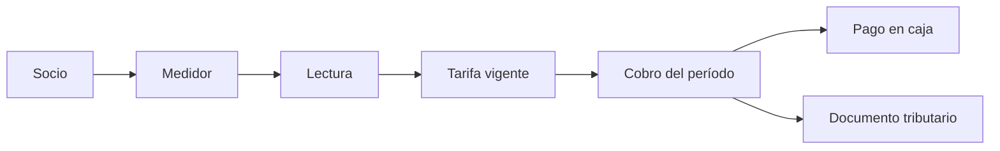
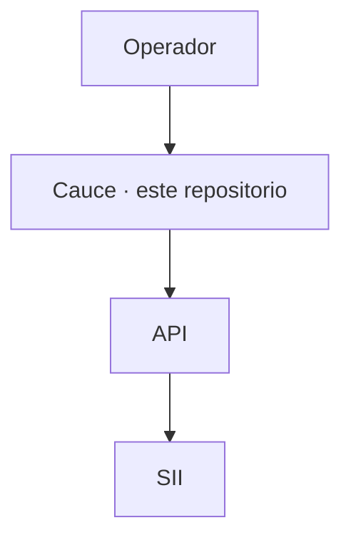

# Cauce

Cliente web del registro operativo de un servicio de agua potable rural.

La unidad de trabajo es el socio, el medidor y el metro cúbico. Cada comité o cooperativa es una sucursal. El mes cierra cuando la lectura, la tarifa vigente y el cobro del período coinciden.

Sitio: [cauce.smartapr.cl](https://cauce.smartapr.cl)

## Ciclo



La lectura anota el consumo del medidor. La tarifa vigente aplica un cargo fijo y después el ancho de cada tramo de m³, en orden, sobre el consumo que queda. El cobro del período produce un cargo por socio. El pago se registra en caja. El documento tributario se emite por el servicio del SII cuando la sucursal tiene folios y resolución configurados.

Tres puestos de trabajo usan el mismo registro:

| Puesto | Entra en | Hace |
| --- | --- | --- |
| Administración | `/dashboard` | Padrón, medidores, tarifa y corrida del mes |
| Medición | `/readings/pos` | Lectura en terreno |
| Caja | `/payments` | Pago del cargo |

## Límite del sistema



Este repositorio es el cliente. No guarda el padrón ni firma documentos: eso ocurre en la API. El cliente se publica como sitio estático. En ejecución habla con la API por `Authorization: Token` y `X-Branch-ID`.

## Repositorio

```
src/app            rutas
src/components     interfaz; el caudal está en components/water
src/lib            cliente HTTP, sesión y reglas de tarifa
public/brand       marca
docs               índice, contrato y registros de revisión
```

El mapa de `src/` está en [src/README.md](src/README.md). El índice de `docs/` está en [docs/README.md](docs/README.md). Cómo copiar el fondo de agua está en [src/components/water/README.md](src/components/water/README.md).

## Desarrollo

El gestor es npm. El archivo de cierre es `package-lock.json`.

```bash
npm ci
npm run dev
```

Sin `NEXT_PUBLIC_YGGDRA_API_BASE`, el modo desarrollo usa `http://localhost:8000/api`. Un build de producción usa `https://api.yggdra.cl/api`.

```bash
npm test
npm run lint
npm run type-check
npm run build
```

La rama `production` compila el export estático y lo publica en cauce.smartapr.cl. La rama de trabajo es `dev`.
