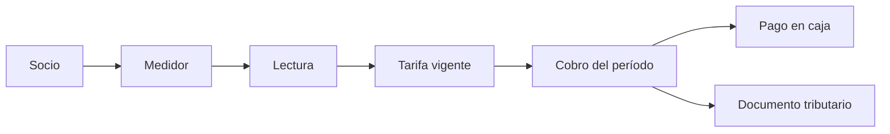
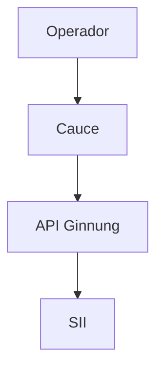

# Arquitectura — Cauce

Cliente Next.js estático para el registro de un APR. La unidad de trabajo es el socio, el medidor y el metro cúbico.

## Estructura

```
src/app            rutas
src/components     interfaz; el dominio de agua está en components/water
src/lib            cliente HTTP, sesión, tarifa y reglas de cobro
public/brand       marca
docs               contrato del cliente y auditorías
```

## Ciclo del mes



La lectura anota el consumo. La tarifa aplica el cargo fijo y después cada tramo de m³. El cobro genera el cargo del socio. El pago se registra en caja. El documento tributario lo emite la API contra el SII cuando la sucursal tiene folios y resolución.

## Puestos

| Puesto | Ruta | Hace |
|--------|------|------|
| Administración | `/dashboard` | Padrón, medidores, tarifa y corrida del mes |
| Medición | `/readings/pos` | Lectura en terreno |
| Caja | `/payments` | Pago del cargo |



Telemetría y agua (`iot-telemetry`, `water`) también pasan por la misma API. Un cambio ahí afecta a Cauce y a Nxord.
